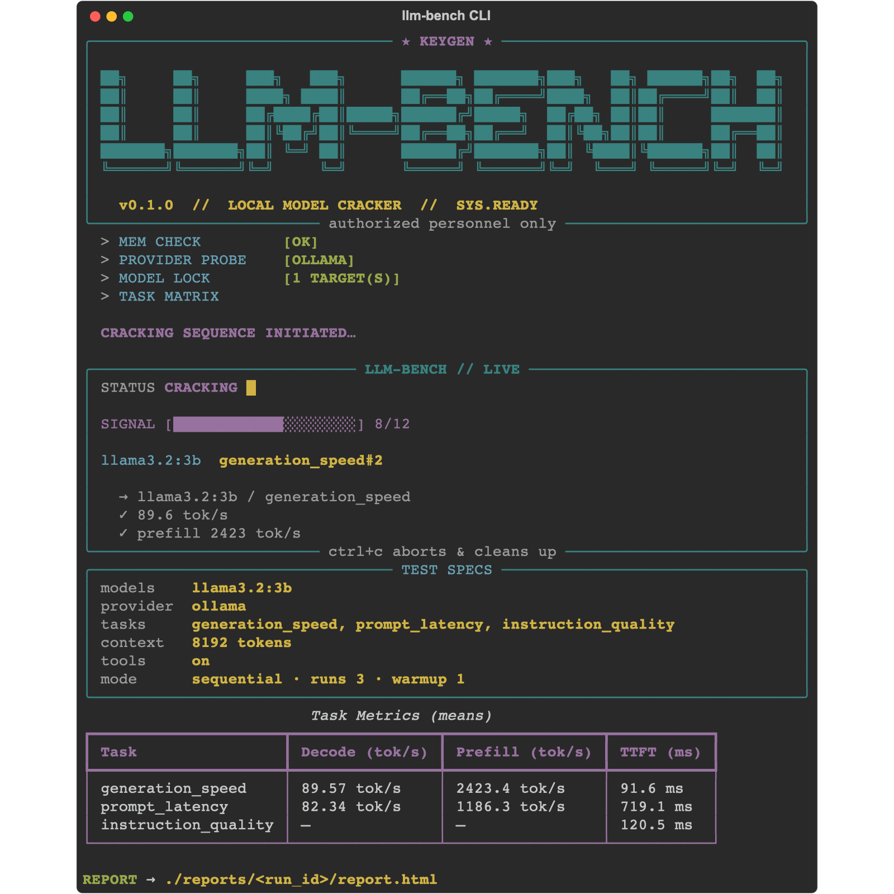
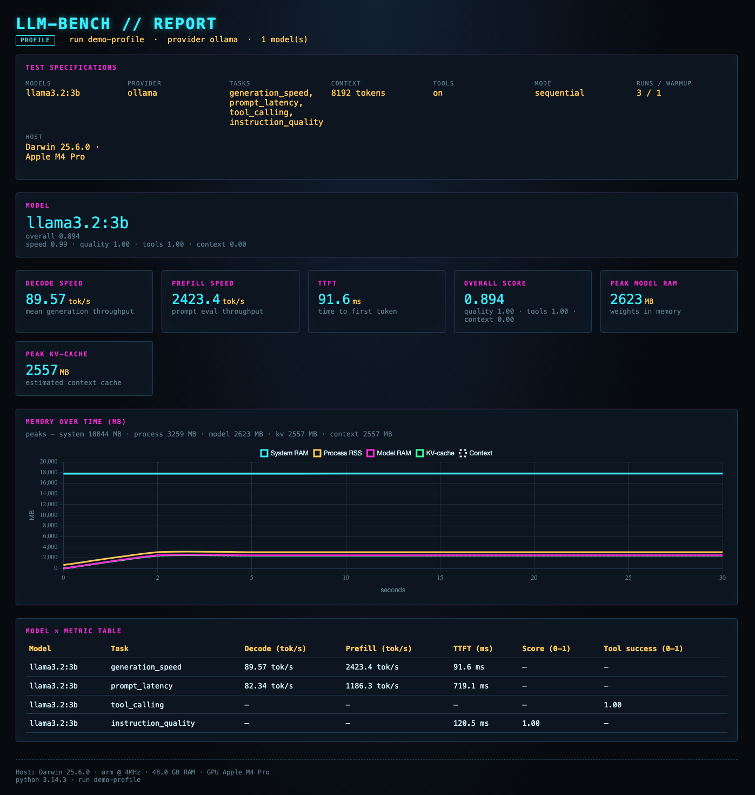

# LLM-BENCH

Retro terminal CLI that benchmarks **local** LLMs on your machine — single-model profiles or multi-model comparisons — across **Ollama**, **llama.cpp**, **MLX**, and **OpenAI-compatible** servers.

## Summary

After each run you get:

- a keygen-style live TUI + ranking/profile board in the terminal
- a self-contained **HTML report** with raw metrics (profile), comparison charts, memory timeline, and tables

Every run is sandboxed in a workspace. When the run finishes (or aborts), llm-bench tears down **processes it started**, **unloads models it loaded**, and **deletes the sandbox**. Only the durable report under `--report` remains (unless you pass `--keep-workspace`).

### CLI



### Report



## Install

```bash
python3 -m venv .venv
source .venv/bin/activate
pip install -e ".[dev]"
```

Optional extras:

```bash
pip install -e ".[mlx]"       # Apple Silicon mlx-lm
pip install -e ".[llamacpp]"  # llama-cpp-python (optional; path mode prefers llama-server binary)
```

## Quick start

Make sure the provider is running first (Ollama: `ollama serve`, then `ollama pull <model>`). If the server is down, llm-bench exits non-zero with a clear error instead of an empty-looking report.

By default, `llm-bench` / `llm-bench run` opens a **setup wizard** (provider, discovered models or custom path/URL, tasks, context, …). Use `--yes` to skip it.

```bash
# Interactive wizard (recommended)
llm-bench run

# Non-interactive
llm-bench run --yes \
  --provider ollama \
  --model llama3.2:3b \
  --tasks speed,latency,quality \
  --context 8192 \
  --tools on \
  --report ./reports

# Compare two models (non-interactive)
llm-bench run --yes -p ollama -m llama3.2:3b -m mistral:7b --tasks speed,quality

# llama.cpp GGUF path or server URL
llm-bench run --yes -p llamacpp -m ./models/model.Q4_K_M.gguf --tasks speed,context
llm-bench run --yes -p openai --base-url http://127.0.0.1:8080/v1 -m local-model

# YAML config still opens the wizard with those defaults; add --yes to skip
llm-bench run -c examples/config.example.yaml --yes
```

### Useful flags

| Flag | Meaning |
|------|---------|
| `-m / --model` | Model name, local path, or URL (**repeatable**; one = profile) |
| `-p / --provider` | `ollama`, `llamacpp`, `mlx`, `openai` |
| `--tasks` | `speed,latency,context,tools,quality` or `all` |
| `--tools on\|off` | Enable/skip tool-calling task |
| `--context` | Context window hint for long-context task |
| `--mode sequential\|parallel` | Multi-model scheduling |
| `--report DIR` | Durable HTML/JSON output (not used as scratch) |
| `--workspace DIR` | Override sandbox root |
| `--keep-workspace` | Keep raw logs after run (default: wipe) |
| `--yes` / `-y` | Skip setup wizard; require flags/config |

```bash
llm-bench list-providers
llm-bench list-tasks
```

## Workspace cleanup contract

Runs use:

```text
~/.cache/llm-bench/runs/<run_id>/
  raw/     # JSONL samples
  tmp/     # scratch only
  report/  # draft artifacts
```

On exit (success, failure, Ctrl+C):

1. Stop child processes **we spawned** (e.g. `llama-server`)
2. Unload models **we loaded** (e.g. Ollama `keep_alive=0`, MLX GC)
3. Delete sandbox `tmp/` and, by default, the whole run workspace
4. Leave only `--report/<run_id>/` (HTML + JSON)

User-owned servers addressed by URL are **not** killed.

## Providers

| Provider | Model value |
|----------|-------------|
| `ollama` | Model name (`llama3.2:3b`) |
| `llamacpp` | `.gguf` path (spawns `llama-server` if available) or server URL |
| `mlx` | HF id / local MLX path (Apple Silicon, `[mlx]` extra) |
| `openai` | Model id on an OpenAI-compatible server (`--base-url`) |

## Development

```bash
pip install -e ".[dev]"
pytest
```

Tests use a mock provider and assert the workspace is removed with no leftover owned processes.

## License

MIT
